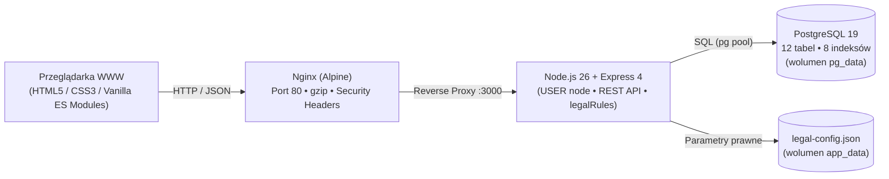

# Cyfrowy Asystent Ocen Okresowych w Służbie Cywilnej

> **HackNation 2026** — otwarte, neutralne technologicznie narzędzie wspierające pełny ustawowy proces ocen okresowych w służbie cywilnej zgodnie z *Ustawą z dnia 21 listopada 2008 r. o służbie cywilnej* oraz *Rozporządzeniem Prezesa Rady Ministrów z dnia 4 kwietnia 2016 r. w sprawie warunków i sposobu przeprowadzania ocen okresowych* (Arkusze **A**, **B** i **C**).

---

## Spis treści

1. [Kluczowe możliwości systemu](#kluczowe-możliwości-systemu)
2. [Realizacja wymagań konkursowych](#realizacja-wymagań-konkursowych)
3. [Architektura i stos technologiczny](#architektura-i-stos-technologiczny)
4. [Szybkie uruchomienie (Docker Compose)](#szybkie-uruchomienie-docker-compose)
5. [Tryb produkcyjny i konfiguracja przepisów](#tryb-produkcyjny-i-konfiguracja-przepisów)
6. [Scenariusz prezentacji / Demo krok po kroku](#scenariusz-prezentacji--demo-krok-po-kroku)
7. [Przegląd REST API i modelu bazy danych](#przegląd-rest-api-i-modelu-bazy-danych)
8. [Testy automatyczne](#testy-automatyczne)
9. [Roadmapa wdrożenia produkcyjnego (RODO i integracje)](#roadmapa-wdrożenia-produkcyjnego-rodo-i-integracje)
10. [Licencja](#licencja)

---

## Kluczowe możliwości systemu

- **Pełny cykl oceny okresowej (Część I–IV)**:
  - Automatyczny dobór arkusza (**A** — kierownik urzędu, **B** — stanowisko kierownicze, **C** — stanowisko nie-kierownicze) i kryteriów obowiązkowych oraz wybór kryteriów dodatkowych (domyślnie maks. 3).
  - **Dwustronne e-podpisy**: podpisanie Części I przez oceniającego **blokuje formularz przed dalszą edycją** (UI + blokada `409 Conflict` po stronie serwera), a podpis ocenianego uruchamia okres oceny.
  - **Ściągawka przed rozmową** (*Podsumowanie poprzedniej oceny*): zwięzłe 3-liniowe podsumowanie ostatniego wyniku, obszarów poniżej oczekiwań i poprzednich wniosków do IPRZ wyświetlane przed rozmową wstępną i w kreatorze oceny.
- **Dziennik zadań i obserwacji z tagowaniem wsadowym**:
  - Przypisywanie wielu tagów jednocześnie (z indywidualną polaryzacją `+` / `−` i wspólną notatką wyjaśniającą) zarówno przy tworzeniu wpisu, jak i do istniejących obserwacji.
  - Kontrola widoczności wpisów: `OBIE_STRONY` vs. prywatne notatki menedżera (`TYLKO_MENEDZER`, filtrowane po stronie serwera).
  - **Wirtualny HR Partner (Dobrostan)**: dedykowane tagi dobrostanowe (`Przeciążenie`, `Nadgodziny`) **nie obniżają oceny formalnej**, lecz wyzwalają alerty wspierające dla przełożonego.
- **Zdarzenia kadrowe i terminy ustawowe**:
  - Automatyczne naliczanie terminów cyklu (24 mies. / 30 dni standardowo; 6 mies. / 7 dni po ocenie negatywnej) oraz automatyczne przesuwanie planowanej daty oceny przy nieobecności powyżej progu (domyślnie >30 dni) i przy zmianie oceniającego.
- **Kreator oceny końcowej ze Split-Screenem i Smart IPRZ**:
  - Krokowe ocenianie w ustawowej skali `1 / 3 / 5 / 7 / 9 pkt` z oficjalnym opisem kryterium, bilansem tagów i pomocniczą wskazówką Asystenta.
  - Automatyczne wyliczanie średniej, poziomu oceny oraz reguły **§ 11** (ocena `1 pkt` w dowolnym kryterium automatycznie wymusza wynik `NEGATYWNA` i blokuje podpis bez uzasadnienia).
  - **Split-Screen uzasadnienia**: klikalne klocki dowodowe z dziennika obserwacji oraz gotowe pigułki rozwojowe do **IPRZ**.
- **Oficjalny wydruk / eksport PDF (Załącznik nr 2, 3 i 4)**:
  - 4-stronicowy arkusz zgodny ze wzorem rozporządzenia z 4 kwietnia 2016 r., dynamicznie odwzorowujący również kryteria dodane lub zmienione przez Administratora.
- **Sprzeciwy (odwołania) i stopnie służbowe**:
  - 7-dniowy tryb odwoławczy pracownika i 14-dniowy termin rozpatrzenia przez Dyrektora Generalnego (`ODRZUCONY`, `UWZGLEDNIONY_ZMIANA` z alertem poprawy dla oceniającego, `UWZGLEDNIONY_PONOWNA_OCENA` z unieważnieniem i podejściem nr 2, `NIEROZPATRZONY_W_TERMINIE`).
  - Automatyczny awans **OBLIGATORYJNY** po dwóch kolejnych ocenach pozytywnych powyżej `6 pkt` oraz wnioski **FAKULTATYWNE** (z wymaganą motywacją przy odrzuceniu).
- **Panel Administratora — pełna elastyczność bez przebudowy kodu**:
  - Zarządzanie użytkownikami i strukturą podległości (`ZMIANA_OCENIAJACEGO` logowana automatycznie).
  - **Zarządzanie tagami**: dodawanie z jednoczesnym mapowaniem na kryteria, pełna edycja i **bezstratne wycofywanie (`soft-delete`)** — historyczne wpisy i statystyki w ocenach nigdy nie znikają.
  - **Zarządzanie kryteriami oceny**: dodawanie, edycja opisów i przypisań do arkuszy (`A`/`B`/`C`: `Obowiązkowe` / `Dodatkowe` / `Nie dotyczy`), ochrona minimum 1 kryterium obowiązkowego na arkusz oraz bezstratne archiwizowanie/przywracanie.
  - **Parametry prawne (Przepisy)**: zmiana częstotliwości ocen, terminów rozmów wstępnych, limitu kryteriów dodatkowych, terminów odwołań i progu nieobecności bezpośrednio z poziomu przeglądarki lub zmiennych środowiskowych.

---

## Realizacja wymagań konkursowych

| Wymaganie | Jak realizuje je system |
| --- | --- |
| **Neutralność technologiczna** | 100% open-source na licencji MIT / BSD / PostgreSQL (Node.js, Express, `pg`, PostgreSQL, Nginx, czysty HTML/CSS/ES Modules). Tylko **2** zależności produkcyjne (`express`, `pg`), zero zewnętrznych CDN (brak Google Fonts — działa w zamkniętych sieciach urzędowych), uruchamiane przez Docker na Linux/Windows/macOS. |
| **Łatwość wdrożenia** | Uruchomienie w **2 komendach** (`cp .env.example .env && docker compose up -d --build`). Automatyczna inicjalizacja 12 tabel, 8 indeksów i słowników ustawowych przy pierwszym starcie. Intuicyjny kreator krok-po-kroku z podpowiedziami prawnymi nie wymaga specjalistycznego szkolenia. |
| **Praca w różnych urzędach** | Obsługuje wszystkie 3 arkusze ustawowe (A, B, C) i 4 role. Dla urzędów o niższym stopniu cyfryzacji zapewnia oficjalny 4-stronicowy wydruk/PDF gotowy do archiwizacji papierowej; dla urzędów cyfrowych — pełny obieg z e-podpisami i REST API. |
| **Łatwość aktualizacji** | Modularny podział na warstwy (`db/`, `domain/`, `middleware/`, `routes/`, modułowe widoki ES), konteneryzacja z healthcheckami i graceful shutdown (`SIGTERM`/`SIGINT`) oraz zestaw testów jednostkowych i integracyjnych (`node:test`). |
| **Zgodność z przepisami** | Pełne odwzorowanie ustawy o SC i rozporządzenia z 4.04.2016 r. (skala 1–9, reguła § 11, terminy 24/6 mies. i 30/7 dni, odwołania, awanse obligatoryjne/fakultatywne, wzory Załączników 2–4). Ochrona danych: serwerowa separacja prywatnych notatek menedżera, brak wycieku `haslo_hash`, zapytania parametryzowane SQL, nagłówki bezpieczeństwa Nginx, brak zewnętrznych skryptów/fontów. |
| **Elastyczność na zmiany przepisów** | Panel Admina pozwala na żywo zmieniać kryteria oceny, przypisania do arkuszy A/B/C, słownik tagów oraz **wszystkie parametry czasowe i liczbowe** (`LEGAL_CONFIG`) bez modyfikacji kodu i bez utraty danych historycznych. |

---

## Architektura i stos technologiczny



### Struktura projektu

```text
.
├── compose.yaml              # Orkiestracja usług: PostgreSQL 19 + Node.js + Nginx
├── .env.example              # Przykładowa konfiguracja środowiska (DB, SEED_DEMO_DATA, LEGAL_*)
├── LICENSE                   # Licencja MIT
├── nginx/
│   └── default.conf          # Reverse proxy, kompresja gzip, nagłówki bezpieczeństwa
└── app/
    ├── Dockerfile            # Obraz Node 26 Alpine (non-root USER node)
    ├── package.json          # Zależności produkcyjne: wyłącznie express + pg
    ├── server.js             # Punkt wejścia Express + inicjalizacja DB + graceful shutdown
    ├── db/
    │   ├── schema.sql        # Pełny schemat bazy danych (12 tabel, 8 indeksów)
    │   ├── init.js           # Automatyczna inicjalizacja schematu i słowników
    │   ├── seed.js           # Słowniki ustawowe + tryb demo lub czyste konto ADMIN
    │   ├── reset.js          # Reset bazy i parametrów prawnych do stanu startowego
    │   ├── pool.js           # Pula połączeń PostgreSQL + wrapper transakcyjny
    │   └── evaluationService.js
    ├── domain/
    │   └── legalRules.js     # Centralny silnik reguł ustawowych i konfiguracja LEGAL_CONFIG
    ├── middleware/
    │   ├── demoAuth.js       # Przełączanie ról demo (X-User-Id) i kontrola uprawnień
    │   └── errorHandler.js   # Jednolita obsługa błędów HTTP i kodów PostgreSQL
    ├── routes/               # Health/Demo Reset, Dictionaries, Legal Config, Tags, Criteria,
    │                         # Users, Evaluations, Tasks, HR Events, Appeals, Rank Requests
    ├── public/
    │   ├── index.html        # Interfejs SPA (zero zewnętrznych CDN)
    │   ├── css/styles.css    # Style UI oraz arkusza wydruku
    │   └── js/               # Modułowy frontend (api, state, utils, main, views/*)
    └── test/                 # Testy jednostkowe i pełne testy integracyjne E2E (node:test)
```

---

## Szybkie uruchomienie (Docker Compose)

Wymagania: **Docker** oraz **Docker Compose** (Linux, macOS lub Windows z Docker Desktop / WSL2).

```bash
cp .env.example .env
docker compose up -d --build
```

Po około 5–10 sekundach aplikacja jest gotowa pod adresem: **http://localhost/** *(lub `http://localhost:<HTTP_PORT>/`, jeśli zmieniono `HTTP_PORT` w `.env`)*.

Przydatne polecenia operacyjne:

```bash
# Podgląd statusu kontenerów i logów
docker compose ps
docker compose logs -f app

# Reset bazy danych do czystego stanu demonstracyjnego (z linii poleceń)
docker compose exec -T app npm run db:reset

# Zatrzymanie środowiska (z zachowaniem danych w wolumenach)
docker compose down
```

> W trybie demonstracyjnym (`SEED_DEMO_DATA=true`) w górnym pasku aplikacji dostępny jest także przycisk **„Resetuj dane demo”**, który przywraca bazę PostgreSQL i parametry prawne jednym kliknięciem.

---

## Tryb produkcyjny i konfiguracja przepisów

### Czyste wdrożenie w urzędzie (bez kont demonstracyjnych)
W pliku `.env` ustaw:

```env
SEED_DEMO_DATA=false
BOOTSTRAP_ADMIN_NAME=Administrator Systemu
BOOTSTRAP_ADMIN_EMAIL=admin@urzad.gov.pl
```

Przy pierwszym uruchomieniu baza zostanie zasilona **wyłącznie ustawowymi słownikami** (14 kryteriów, 42 przypisania do arkuszy A/B/C, 16 tagów) oraz pojedynczym kontem startowym `ADMIN`. Endpoint `POST /api/demo/reset` zostaje automatycznie zablokowany (`403 Forbidden`).

### Elastyczne parametry prawne (`LEGAL_*` / Panel Admina)
Wszystkie parametry czasowe i liczbowe można dostosować w **Panelu Admina → Parametry prawne (Przepisy)** lub przez zmienne środowiskowe w `.env`:

| Zmienna środowiskowa | Opis parametru | Wartość ustawowa |
| --- | --- | :---: |
| `LEGAL_CYCLE_MONTHS` | Standardowa długość okresu oceny (mies.) | `24` |
| `LEGAL_CYCLE_MONTHS_AFTER_NEGATIVE` | Okres oceny po ocenie negatywnej (mies.) | `6` |
| `LEGAL_INITIAL_INTERVIEW_DAYS` | Limit rozmowy wstępnej — tryb standardowy (dni) | `30` |
| `LEGAL_INITIAL_INTERVIEW_DAYS_AFTER_NEGATIVE` | Limit rozmowy wstępnej po ocenie negatywnej (dni) | `7` |
| `LEGAL_MAX_ADDITIONAL_CRITERIA` | Maksymalna liczba kryteriów dodatkowych | `3` |
| `LEGAL_ABSENCE_SHIFT_THRESHOLD_DAYS` | Próg nieobecności przesuwającej termin oceny (dni) | `30` |
| `LEGAL_APPEAL_DAYS_LIMIT` | Termin złożenia sprzeciwu przez pracownika (dni) | `7` |
| `LEGAL_APPEAL_REVIEW_DAYS_LIMIT` | Termin rozpatrzenia sprzeciwu przez Dyrektora (dni) | `14` |

---

## Przegląd REST API i modelu bazy danych

### Model bazy danych ([schema.sql](app/db/schema.sql))
12 tabel relacyjnych w PostgreSQL 19 z kluczami obcymi, więzami `CHECK` i 8 indeksami:
`uzytkownicy`, `slownik_kryteriow`, `arkusz_kryteria`, `oceny_okresowe`, `ocena_kryteria_wyniki`, `slownik_tagow`, `tag_kryteria`, `zadania_obserwacje`, `zadanie_tagi`, `zdarzenia_kadrowe`, `sprzeciwy_odwolania`, `wnioski_stopien_sluzbowy`.

### Główne grupy endpointów (`/api`)
- **System**: `GET /health`, `GET /test-db`, `POST /demo/reset` *(tylko w trybie demo)*
- **Słowniki i przepisy**: `GET /dictionaries`, `GET|PUT /legal-config`, `POST /legal-config/reset`
- **Admin — Tagi i Kryteria**: `GET|POST /tags`, `PUT|DELETE /tags/:id`, `PATCH /tags/:id/restore`, `GET|POST /criteria`, `PUT|DELETE /criteria/:id`, `PATCH /criteria/:id/restore`
- **Użytkownicy**: `GET|POST /users`, `GET /users/:id/workspace`, `PATCH /users/:id/evaluator`
- **Oceny okresowe**: `GET /evaluations`, `GET /evaluations/:id`, `PUT /evaluations/:id/setup`, `POST /evaluations/:id/sign-criteria`, `POST /evaluations/:id/start-review`, `POST /evaluations/:id/finalize`, `POST /evaluations/:id/acknowledge`
- **Dziennik i zdarzenia kadrowe**: `GET|POST /evaluations/:evalId/tasks`, `DELETE /tasks/:taskId`, `POST /tasks/:taskId/tags`, `DELETE /tasks/:taskId/tags/:taskTagId`, `GET|POST /evaluations/:evalId/hr-events`, `DELETE /hr-events/:eventId`
- **Odwołania i stopnie służbowe**: `GET /appeals`, `POST /evaluations/:evalId/appeals`, `PATCH /appeals/:id/decide`, `GET /rank-requests`, `PATCH /rank-requests/:id/decide`

---

## Testy automatyczne

Aplikacja korzysta z wbudowanego runnera `node:test` (zero zewnętrznych zależności testowych):

```bash
# Testy jednostkowe i modułowe (reguły prawne, formatowanie dat, ściągawka, wydruk)
cd app && npm run test:unit

# Pełne testy integracyjne E2E przeciwko uruchomionemu stackowi Docker + PostgreSQL + Nginx
cd app && API_BASE_URL=http://localhost npm run test:api
```

---

## Roadmapa wdrożenia produkcyjnego (RODO i integracje)

Wersja hackathonowa używa szybkiego przełączania ról (`X-User-Id`), aby ułatwić prezentację całego obiegu bez logowania. Przed wdrożeniem produkcyjnym w urzędzie przewidziano następujące, modułowe rozszerzenia (bez zmiany logiki domenowej ani schematu ocen):

1. **Uwierzytelnianie i SSO**: zastąpienie `middleware/demoAuth.js` integracją z **Active Directory / LDAP / OIDC / Węzłem Krajowym** oraz sesjami `HttpOnly` + rolą `KADRY` i zakresem `GET /api/users` ograniczonym do podległych komórek (zasada minimalizacji RODO art. 5 ust. 1 lit. c).
2. **Szyfrowanie i dziennik audytu (RODO art. 5 ust. 2 i art. 32)**: terminacja **TLS 1.2/1.3 + HSTS + CSP** w Nginx, rejestr dostępu i zmian danych osobowych oraz polityka retencji/anonimizacji.
3. **Kwalifikowany e-podpis i integracje**: podpięcie **Profilu Zaufanego / podpisu kwalifikowanego** do znaczników e-podpisu, import masowy kadr (CSV/AD) oraz eksport do systemów **EZD RP**.

---

## Licencja

Projekt udostępniany na otwartej licencji [MIT](LICENSE) — bez opłat licencyjnych i ograniczeń wdrożeniowych w jednostkach administracji publicznej.
